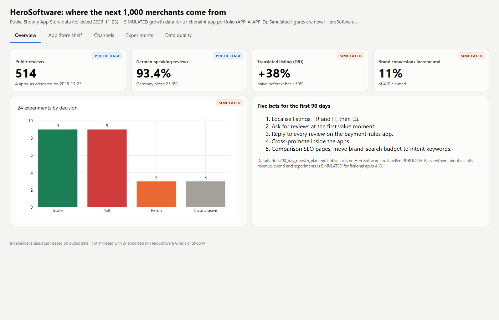
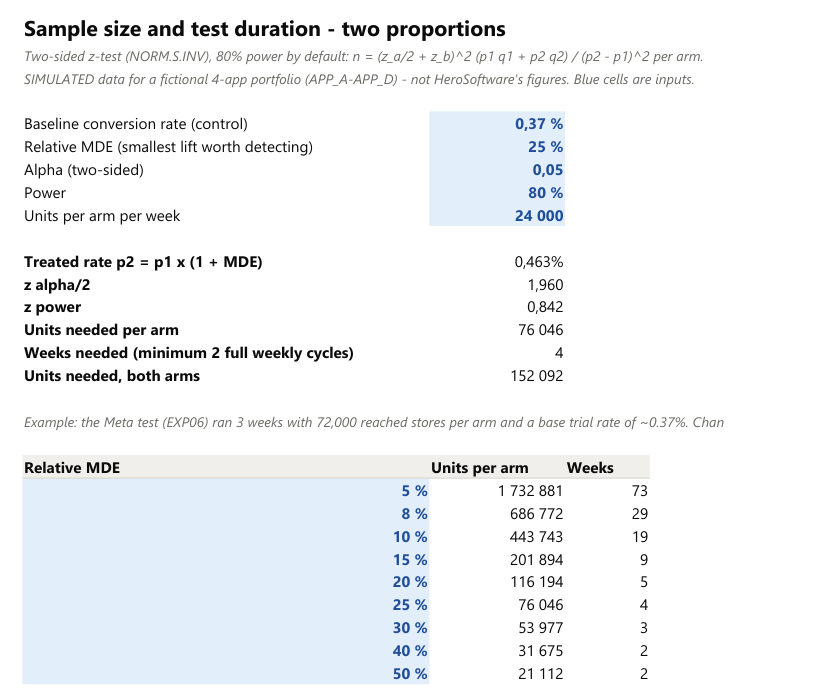

# HeroSoftware: where the next 1,000 merchants come from

## 📄 [Read the report (PDF, 7 pages)](https://albt-france.github.io/herosoftware-shopify-app-growth-case-study/report/HeroSoftware_growth_case_study.pdf) · 📊 [Open the interactive dashboard](https://albt-france.github.io/herosoftware-shopify-app-growth-case-study/dashboard/)

**A test-and-kill growth system for four Shopify apps** · independent case study based on public data · not affiliated
with or endorsed by HeroSoftware GmbH or Shopify.

- **Report (7 pages):** [online](https://albt-france.github.io/herosoftware-shopify-app-growth-case-study/report/HeroSoftware_growth_case_study.pdf) · [in the repo](report/HeroSoftware_growth_case_study.pdf)
- **Dashboard (5 tabs):** [online](https://albt-france.github.io/herosoftware-shopify-app-growth-case-study/dashboard/) · [in the repo](dashboard/index.html)
- **Experiment tracker (Excel, live formulas):** [excel/growth_experiment_tracker.xlsx](excel/growth_experiment_tracker.xlsx)
- **Notebook (re-runs everything):** [notebooks/herosoftware_growth.ipynb](notebooks/herosoftware_growth.ipynb)
- **Docs:** [playbook](docs/growth_experiment_playbook.md) · [experiment log](docs/experiment_log.md) ·
  [listing audit](docs/app_store_listing_audit.md) · [channel playbooks](docs/channel_playbooks.md) ·
  [90-day plan](docs/90_day_growth_plan.md) · [weekly update](docs/weekly_growth_update.md) ·
  [KPI dictionary](docs/kpi_dictionary.md) · [data issues](docs/data_issues_log.md) · [assumptions](docs/assumptions.md)

Two kinds of data, labelled on every visual:
**PUBLIC DATA** = Shopify App Store listings, reviews and category pages, Eurostat, ECB, company pages, as observed on
2026-11-23. **SIMULATED** = one year of growth data for a fictional portfolio of 4 apps (APP_A-APP_D) calibrated on the
public facts. Simulated figures are never HeroSoftware's figures.



## The question

With four "Built for Shopify" apps rated 4.9+ but a review base that is 93% German-speaking, which channels should be
tested, how do we know quickly what works, and what do we stop?

## 4 key results

1. **PUBLIC DATA - demand is German-speaking, the listings are not.** 93.4% of the 514 public reviews come from
   Germany, Austria and Switzerland (85.0% Germany), while all 4 listings declare English only and two short
   descriptions are in German. Translating the listings is the first lever.
2. **PUBLIC DATA - the shelf under-uses the reviews.** PaymentHero is 7th of 402 apps by number of reviews but shown
   30th in its category (one logged-out observation); it has 0% developer replies (AddressHero 100%) and no new review
   since 2026-02-24. In all 4 categories, apps shown in the top 30 have a free plan far more often (50-67% vs 7-27%).
3. **SIMULATED - test, scale or kill.** 24 experiments: 9 scaled, 9 killed, 3 rerun, 3 inconclusive. A translated
   listing lifts installs by +38% vs control countries (difference-in-differences) where the naive before/after says
   +50%; App Store ads are killed (41% uninstall within 48 h, CAC about 4x the other paid channels); a 3-week Meta test
   is inconclusive, not a failure (MDE 24%).
4. **SIMULATED - don't fool yourself.** Black Friday makes a LinkedIn push look like a win (DiD -14%, CI -38% to +19%);
   Google Ads claims 410 brand conversions but a geo holdout finds ~11% incremental; Simpson's paradox hides that the
   newest app converts better in every region; 1,133 duplicated webhooks would have inflated July.

## How to re-run

```
pip install -r requirements.txt
python src/collect_public.py
python src/simulate_growth.py
python src/run_sql.py
python src/build_excel.py
python src/build_dashboard.py
python src/build_pdf.py
```

- `collect_public.py` re-uses the delivered CSVs in `data/public/` when the raw page cache (`data/raw/`, not shipped)
  is absent: no request is sent. With an empty `data/public/`, it collects again politely (about 3 minutes).
- `run_sql.py` runs `sql/01..10` and `sql/99_tests.sql` in DuckDB and stops if an assertion fails.
- `build_excel.py` recalculates the workbook with LibreOffice (if installed) and compares it with Python.
- `build_pdf.py` prints the HTML pages with headless Microsoft Edge (or Chrome).
- `python src/build_notebook.py` re-executes the notebook.

## The Excel tracker in two examples

Sheet `Sample_Size` (blue cells are inputs). With a baseline trial rate of 0.37% per reached store and 24,000 stores
per arm per week (the Meta test, EXP06):

- **MDE 25%** -> 76,046 stores per arm -> **4 weeks**.
- **MDE 8%** -> 686,772 stores per arm -> **29 weeks**: why a 3-week test could not see a +8% effect.



Other sheets: `Backlog` (ICE = average of Impact, Confidence, Ease, ranked), `Readouts` (lift, 95% CI, p-value and a
decision by formula), `Channel_Scorecard` (CAC, payback), `Checks` (control sums vs SQL outputs, all OK).

## Methods

- Python (pandas, NumPy, SciPy), DuckDB SQL with CTEs and window functions, 11 SQL scripts including assertions.
- Experiments: two-proportion tests with delta-method CIs, sample size and MDE before launch, geo
  difference-in-differences when the App Store allows no A/B test, geo holdout for paid-media incrementality.
- Data cleaning: webhook retries, re-installs within 24 h, UTC -> Europe/Berlin (`sql/01_staging.sql`).
- No LLM is called in the study.

> AI-assisted workflow: I used Claude, mainly to write scripts faster. I drove the project: I defined the questions, chose and validated the data sources, made the analytical decisions and checked every result.

## Sources and terms

| Source | Use | Terms |
|---|---|---|
| Shopify App Store (apps.shopify.com): 4 listings, 514 reviews, 4 category shelves (2,568 apps) | facts quoted "as observed on the Shopify App Store on 2026-11-23" | public pages; robots.txt respected; no review text, shop name or reply text collected or republished |
| Wayback Machine (web.archive.org) | review history of 2 category leaders | public archive; the service refused further connections, not retried |
| Eurostat `isoc_ec_eseln2` (2024) | country prioritisation | free re-use with acknowledgement |
| ECB reference rates (data-api.ecb.europa.eu) | EUR/USD conversion | re-use with source |
| hero.software (legal notice), join.com job ad | company and job facts, as stated by HeroSoftware | public pages; no person named |

Collection rules: robots.txt read first (`*q=*` is disallowed on apps.shopify.com, so no search page and no keyword
ranking), at most one request every 1.5 s (2 s for the Wayback Machine), one cached pass, a neutral User-Agent, no
account, no app install, no form, no message.

## Limits

- A review is an indirect signal, not an install; the review-per-install rate is unknown.
- Category order was observed once, logged out; it can be personalised and change daily. It is not Shopify's ranking
  algorithm.
- No keyword ranking (robots.txt), no Google Trends, no paid tools, no LinkedIn company data.
- Eurostat counts enterprises with 10+ staff, not Shopify merchants.
- Everything about installs, trials, revenue, spend and experiments is SIMULATED. The simulated country mix gives
  non-DACH markets more weight than the public reviews so that country tests have volume.
- Review peaks (May-June 2025) are consistent with a review-request push; public data cannot tell how reviews were
  requested.

## Repository

```
src/        collection, simulation, SQL runner, Excel, dashboard, charts, PDF, notebook builder
sql/        01_staging ... 10_category_landscape, 99_tests
data/       public/ (PUBLIC DATA, CSV), sim/ (SIMULATED, parquet), out/ (SQL outputs, facts.json)
docs/       playbook, experiment log (.md + .csv), audit, channel playbooks, plan, weekly update, KPIs, data issues, assumptions
excel/      growth_experiment_tracker.xlsx
dashboard/  index.html (self-contained)
report/     7-page PDF + chart images
notebooks/  herosoftware_growth.ipynb
```
